<!-- _class: tytul -->

<p class="eyebrow">Akademia Leona Koźmińskiego · Informatyka, I rok · 03.11.2026</p>

# Lab 04
## Pętle
**dr inż. Karol Chlasta** · WarsawIQ

Repozytorium kursu: [github.com/KarolChlasta/KU-PyDev](https://github.com/KarolChlasta/KU-PyDev)

---

# Cel zajęć

- Rozumieć **iterację**: jak powtarzać instrukcje bez kopiowania kodu
- Pętle `for` i `while`, funkcja `range()`, instrukcje `break` i `continue`
- Pętle zagnieżdżone i pierwsze spojrzenie na **koszt algorytmu**
- Wzorce: **akumulator**, **licznik**, **wartownik**
- Efekty z sylabusa: **U1**, **U3** (algorytmy z pętlami), **KS1**

---

<!-- _class: sekcja -->

# Część I
## Teoria: iteracja

---

# Dwie pętle, dwa pytania

| | `for` | `while` |
|---|---|---|
| Pytanie | „dla **każdego** elementu…” | „**dopóki** warunek jest prawdziwy…” |
| Liczba powtórzeń | znana z góry (długość kolekcji) | nieznana z góry |
| Typowe użycie | lista, tekst, `range()` | menu, gra, wczytywanie danych |
| Ryzyko | małe | **pętla nieskończona** |

```python
for letter in "ALK":
    print(letter)          # A, L, K

n = 3
while n > 0:
    print(n)               # 3, 2, 1
    n -= 1
```

---

# `range(start, stop, step)`

| Wywołanie | Wartości |
|---|---|
| `range(5)` | 0, 1, 2, 3, 4 |
| `range(1, 6)` | 1, 2, 3, 4, 5 |
| `range(0, 10, 3)` | 0, 3, 6, 9 |
| `range(5, 0, -1)` | 5, 4, 3, 2, 1 |

- `stop` **nie należy** do zakresu – tak jak w wycinkach list
- `range` nie tworzy listy w pamięci, tylko **generuje** kolejne liczby: `range(10**12)` zajmuje kilkadziesiąt bajtów

<p class="zrodlo">E. W. Dijkstra, „Why numbering should start at zero” (EWD831, 1982) – uzasadnienie przedziałów lewostronnie domkniętych.</p>

---

# Po czym iterujemy?

```python
for x in [3, 1, 2]: ...                  # elementy listy
for ch in "Python": ...                  # znaki tekstu
for key, value in {"a": 1}.items(): ...  # pary ze słownika
for i, name in enumerate(["Ala", "Ola"], start=1):
    print(i, name)                       # 1 Ala, 2 Ola
for a, b in zip([1, 2], ["x", "y"]):
    print(a, b)                          # 1 x, 2 y
```

- `for` działa z każdym obiektem **iterowalnym** – takim, który potrafi podawać kolejne elementy
- `enumerate` daje numer, `zip` łączy kilka kolekcji „na suwak”

---

# `break`, `continue` i `else`

```python
while True:
    line = input("Ocena: ")
    if line == "":
        break            # wyjdź z pętli
    if not line.isdigit():
        continue         # pomiń resztę tego obrotu
    ...
```

- `break` kończy **najbliższą** pętlę, `continue` przechodzi do kolejnego obrotu
- `else` przy pętli wykona się, gdy pętla **nie** została przerwana przez `break`:

```python
for d in range(2, n):
    if n % d == 0:
        print("złożona"); break
else:
    print("pierwsza")
```

---

# Wzorce pętli

| Wzorzec | Idea | Przykład |
|---|---|---|
| **akumulator** | zmienna zbiera wynik | `total += x` |
| **licznik** | zlicza wystąpienia | `count += 1` |
| **wartownik** | specjalna wartość kończy dane | pusta linia, `-1` |
| **szukanie ekstremum** | pamiętaj najlepszy dotąd | `if x > best: best = x` |
| **flaga** | pamiętaj, czy coś zaszło | `found = True` |

- Większość algorytmów na tym kursie to kombinacje tych pięciu wzorców

---

# Pętla `while` a poprawność

- Każda pętla `while` potrzebuje **postępu**: czegoś, co zbliża ją do końca

```python
# Algorytm Euklidesa (ok. 300 r. p.n.e.) – NWD dwóch liczb
a, b = 1071, 462
while b != 0:
    a, b = b, a % b
print(a)   # 21
```

- Tu postęp jest pewny: `b` maleje przy każdym obrocie, a jest nieujemne
- **Niezmiennik pętli**: własność prawdziwa przed i po każdym obrocie (tu: NWD(a, b) się nie zmienia)
- Zawieszony program przerwiesz w terminalu: **Ctrl+C** (`KeyboardInterrupt`)

---

# Pętle zagnieżdżone i koszt

```python
for i in range(1, n + 1):
    for j in range(1, n + 1):
        print(f"{i * j:4}", end="")
    print()
```

| n | Liczba mnożeń |
|---|---|
| 10 | 100 |
| 100 | 10 000 |
| 1000 | 1 000 000 |

- Dwie zagnieżdżone pętle po `n` → **n²** operacji
- Notację Big O poznamy dokładnie w labie 13 (sortowanie i wyszukiwanie)

---

<!-- _class: sekcja -->

# Część II
## Praktyka

---

# Rozkład liczby na cyfry

```python
n = 12345
while n > 0:
    digit = n % 10      # ostatnia cyfra: 5, 4, 3, 2, 1
    n //= 10            # odetnij ostatnią cyfrę
```

| `n` | `n % 10` | `n // 10` |
|---|---|---|
| 12345 | 5 | 1234 |
| 1234 | 4 | 123 |
| … | … | … |
| 1 | 1 | 0 |

- Uwaga na **0**: pętla `while n > 0` nie wykona się ani razu – a 0 ma jedną cyfrę

---

# Ciekawostki 🔁

- **Ada Lovelace** w notatkach do maszyny analitycznej Babbage'a (1843, *Note G*) opisała algorytm liczenia liczb Bernoulliego z **powtarzanymi krokami** – uważany za pierwszy program
- 9.09.1947 zespół komputera **Harvard Mark II** wkleił do dziennika ćmę znalezioną w przekaźniku z dopiskiem *„first actual case of bug being found”*
- Siedziba Apple w Cupertino przez lata miała adres **1 Infinite Loop**
- **Problem Collatza** (1937): „jeśli n parzyste → n/2, inaczej → 3n+1”. Czy pętla zawsze dojdzie do 1? Nikt tego nie udowodnił

---

# Ciekawostki: crawlery 🕷️

- Wyszukiwarki indeksują internet **crawlerami** – programami, które w pętli pobierają strony i dodają znalezione linki do kolejki
- Uprzejmy crawler czyta najpierw plik **`robots.txt`** – konwencja z 1994 r. (Martijn Koster), od 2022 r. standard **RFC 9309**
- Nasz mini-crawler czyta lokalny plik, więc nikomu nie przeszkadza

---

<!-- _class: sekcja -->

# Ciekawostka
## Biblioteki Pythona – przegląd

---

<style scoped>section { font-size: 22px; } h1 { font-size: 36px; } pre { font-size: 18px; }</style>

# Baterie w zestawie 🔋

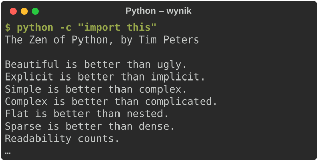

- **Biblioteka standardowa**: 190+ modułów bez instalacji (`math`, `csv`, `json`…) – *„batteries included”* (PEP 206)
- **[PyPI](https://pypi.org)**: 932 072 projekty (03.11.2026), instalacja `pip install` – zrobimy to 15.12
- Hit października 2026: **boto3** (AWS), ok. 2,7 mld pobrań; `requests` – 8. miejsce
- Pisanki: `import this` i `import antigravity` (komiks xkcd 353)

---

<style scoped>section { font-size: 22px; } h1 { font-size: 36px; } pre { font-size: 18px; }</style>

# Analiza danych: pandas 🐼

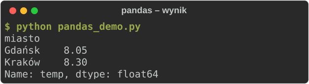

- Tabele jak w Excelu, tylko w kodzie · [pandas.pydata.org](https://pandas.pydata.org)
- Dane przykładowe

```python
import pandas as pd

df = pd.DataFrame({
    "miasto": ["Kraków", "Gdańsk"] * 2,
    "temp": [11.2, 10.1, 5.4, 6.0],
})
print(df.groupby("miasto")["temp"].mean())
```

---

<style scoped>section { font-size: 22px; } h1 { font-size: 36px; } pre { font-size: 18px; }</style>

# Wykresy: Matplotlib 📈

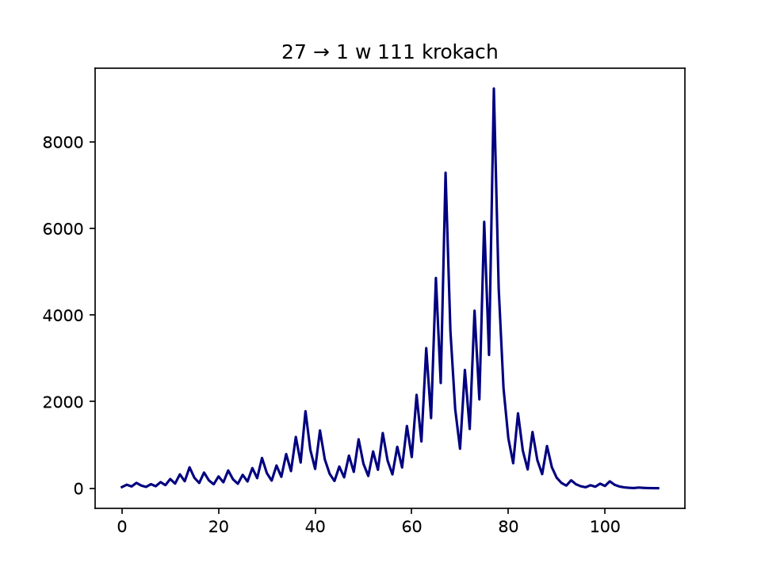

- Wykres z pętli `while` – problem Collatza z dzisiejszych ciekawostek · [matplotlib.org](https://matplotlib.org)

```python
import matplotlib.pyplot as plt

n, steps = 27, [27]
while n != 1:
    n = n // 2 if n % 2 == 0 else 3 * n + 1
    steps.append(n)

plt.plot(steps, color="navy")
plt.title(f"27 → 1 w {len(steps) - 1} krokach")
plt.savefig("collatz.png", dpi=150)
```

---

<style scoped>section { font-size: 22px; } h1 { font-size: 36px; } pre { font-size: 18px; }</style>

# Obliczenia: NumPy ⚡

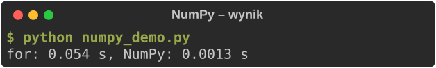

- Działa na całych tablicach: pętla dzieje się „za kulisami” w skompilowanym C · [numpy.org](https://numpy.org)
- Pomiar na laptopie prowadzącego

```python
import time
import numpy as np

t = time.perf_counter()
squares = []
for x in range(1_000_000):
    squares.append(x * x)
t_for = time.perf_counter() - t
t = time.perf_counter()
squares_np = np.arange(1_000_000) ** 2
t_np = time.perf_counter() - t
print(f"for: {t_for:.3f} s, NumPy: {t_np:.4f} s")
```

---

<style scoped>section { font-size: 22px; } h1 { font-size: 36px; } pre { font-size: 18px; }</style>

# Internet: Requests 🌐

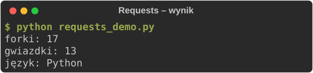

- Dane z sieci w jednej linii – tu API GitHuba o naszym repo · [requests.readthedocs.io](https://requests.readthedocs.io)

```python
import requests

url = ("https://api.github.com/repos/"
       "KarolChlasta/KU-PyDev")
repo = requests.get(url, timeout=10).json()
print("forki:", repo["forks_count"])
print("gwiazdki:", repo["stargazers_count"])
print("język:", repo["language"])
```

---

<style scoped>section { font-size: 22px; } h1 { font-size: 36px; } pre { font-size: 18px; }</style>

# Strony WWW: Beautiful Soup 🍲

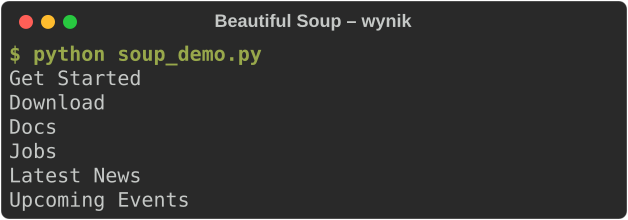

- Wyciąga dane z HTML – nagłówki strony python.org · [crummy.com/software/BeautifulSoup](https://www.crummy.com/software/BeautifulSoup/)

```python
import requests
from bs4 import BeautifulSoup

url = "https://www.python.org"
html = requests.get(url, timeout=10).text
soup = BeautifulSoup(html, "html.parser")
for h2 in soup.find_all("h2")[:6]:
    print(h2.get_text(strip=True))
```

---

<style scoped>section { font-size: 22px; } h1 { font-size: 36px; } pre { font-size: 18px; }</style>

# Aplikacje webowe: FastAPI 🚀

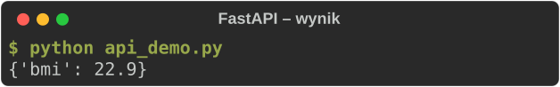

- BMI z Lab 01 jako usługa sieciowa; dokumentacja API sama powstaje pod `/docs` · [fastapi.tiangolo.com](https://fastapi.tiangolo.com)
- Inne: [Django](https://www.djangoproject.com), [Flask](https://flask.palletsprojects.com)

```python
from fastapi import FastAPI
from fastapi.testclient import TestClient

app = FastAPI()

@app.get("/bmi")
def bmi(weight: float, height: float):
    return {"bmi": round(weight / height**2, 1)}

client = TestClient(app)
resp = client.get("/bmi?weight=70&height=1.75")
print(resp.json())
```

---

<style scoped>section { font-size: 22px; } h1 { font-size: 36px; } pre { font-size: 18px; }</style>

# Gry: pygame 🎮


- Każda gra to pętla: ruch → odbicie → rysowanie · [pygame.org](https://www.pygame.org) · [GitHub](https://github.com/pygame/pygame)

```python
import pygame
pygame.init()
screen = pygame.display.set_mode((480, 320))
screen.fill("navy")
x, y, dx, dy = 40, 40, 7, 5
for frame in range(400):
    x, y = x + dx, y + dy
    if not 20 <= x <= 460:
        dx = -dx
    if not 20 <= y <= 300:
        dy = -dy
    pygame.draw.circle(screen, "gold", (x, y), 5)
pygame.image.save(screen, "frame.png")
```

---

<style scoped>section { font-size: 22px; } h1 { font-size: 36px; } pre { font-size: 18px; }</style>

# Terminal: Rich i tqdm 🖥️

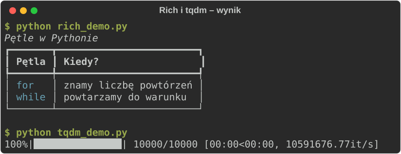

- Kolorowe tabele w terminalu · [rich.readthedocs.io](https://rich.readthedocs.io)
- [tqdm](https://tqdm.github.io): pasek postępu do pętli `for i in tqdm(range(10_000)):`. Nazwa od arabskiego *taqaddum*, czyli „postęp”

```python
from rich.console import Console
from rich.table import Table

table = Table(title="Pętle w Pythonie")
table.add_column("Pętla", style="cyan")
table.add_column("Kiedy?")
table.add_row("for", "znamy liczbę powtórzeń")
table.add_row("while", "powtarzamy do warunku")
Console().print(table)
```

---

<style scoped>section { font-size: 22px; } h1 { font-size: 36px; } pre { font-size: 18px; }</style>

# Obrazy: Pillow i qrcode 🖼️

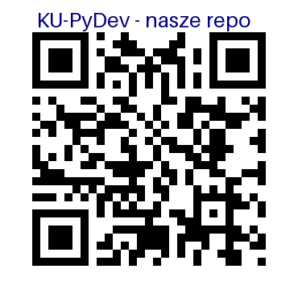

- Zeskanuj – ten kod wygenerował program obok · [python-pillow.org](https://python-pillow.org), [qrcode](https://pypi.org/project/qrcode/)

```python
import qrcode
from PIL import ImageDraw, ImageFont

url = "https://github.com/KarolChlasta/KU-PyDev"
img = qrcode.make(url).get_image().convert("RGB")
draw = ImageDraw.Draw(img)
font = ImageFont.load_default(size=26)
draw.text((45, 8), "KU-PyDev - nasze repo",
          fill="navy", font=font)
img.save("qr.png")
```

---

<style scoped>section { font-size: 22px; } h1 { font-size: 36px; } pre { font-size: 18px; }</style>

# Uczenie maszynowe: scikit-learn 🤖

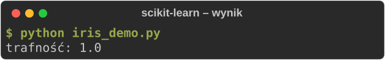

- Rozpoznawanie gatunków irysów (zbiór Fishera z 1936 r.) · [scikit-learn.org](https://scikit-learn.org)
- Sieci neuronowe: [PyTorch](https://pytorch.org)

```python
from sklearn.datasets import load_iris
from sklearn.model_selection import (
    train_test_split)
from sklearn.neighbors import (
    KNeighborsClassifier)

X, y = load_iris(return_X_y=True)
Xa, Xb, ya, yb = train_test_split(
    X, y, random_state=42)
model = KNeighborsClassifier().fit(Xa, ya)
print("trafność:", model.score(Xb, yb))
```

---

<style scoped>section { font-size: 22px; } h1 { font-size: 36px; } pre { font-size: 18px; }</style>

# Testy: pytest ✅

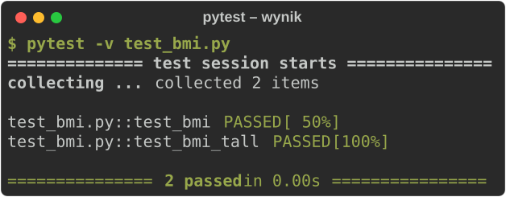

- Test to zwykła funkcja z `assert` · [docs.pytest.org](https://docs.pytest.org)
- My używamy `unittest` – porównamy na labie z TDD (19.01)

```python
# test_bmi.py
def bmi(weight, height):
    return round(weight / height**2, 1)

def test_bmi():
    assert bmi(70, 1.75) == 22.9

def test_bmi_tall():
    assert bmi(90, 2.0) == 22.5
```

---

<style scoped>section { font-size: 22px; } h1 { font-size: 36px; } pre { font-size: 18px; }</style>

# Gdzie szukać więcej? 🔎

| Zastosowanie | Biblioteki |
|---|---|
| dane i wykresy | pandas, NumPy, Matplotlib |
| internet i WWW | Requests, Beautiful Soup, FastAPI, Django, Flask |
| aplikacje z danymi | [Streamlit](https://streamlit.io) |
| Excel | [openpyxl](https://openpyxl.readthedocs.io) |
| gry, obrazy, terminal | pygame, Pillow, Rich, tqdm |
| AI | scikit-learn, PyTorch |
| testy | unittest (wbudowany), pytest |

- Katalog bibliotek według dziedzin: [github.com/vinta/awesome-python](https://github.com/vinta/awesome-python)
- Wyszukiwarka pakietów: [pypi.org](https://pypi.org) · biblioteka standardowa: [docs.python.org/3/library](https://docs.python.org/3/library/)

---

# Dzisiejsze zadania

| | Plik | Zadanie |
|---|---|---|
| ★ | `zad1_srednia.py` | średnia ocen do pustej linii |
| ★ | `zad2_tabliczka.py` | tabliczka mnożenia n × n |
| ★ | `zad3_suma_cyfr.py` | suma i liczba cyfr |
| ★ | `zad4_zgadywanka.py` | zgadnij liczbę |
| ☆ | `zad5_crawler.py` | mini-crawler |

---

# Sprawdzenie i oddanie

```bash
cd lab04_petle
python -m unittest discover -s tests -v
git add .
git commit -m "Lab 04"
git push
```

- Punkt aktywności: **obecność + wszystkie testy ★ zielone + push na GitHub przed 11:45**
- Po zajęciach – **0 pkt**, bez wyjątków
- Pamiętaj: **Sync fork** na początku zajęć, żeby pobrać nowy lab

---

# Do poczytania

- E. Matthes, *Python. Instrukcje dla programisty*, Helion 2023 – rozdz. 4 i 7
- M. Dawson, *Python dla każdego*, Helion 2015 – rozdz. 3–4
- Dokumentacja: *More Control Flow Tools* (*docs.python.org/3/tutorial/controlflow.html*)

**Następny lab (24.11):** listy i krotki
